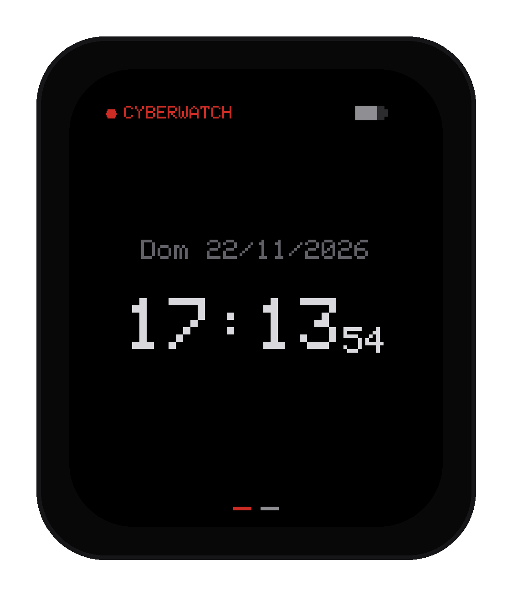
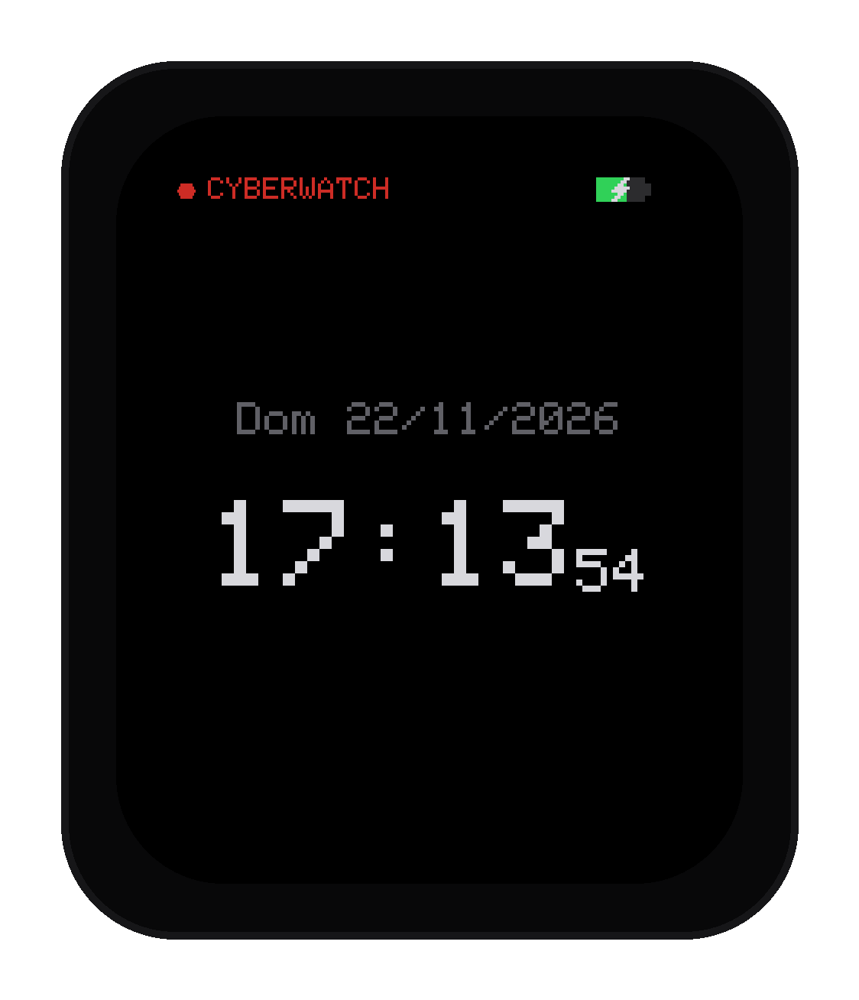
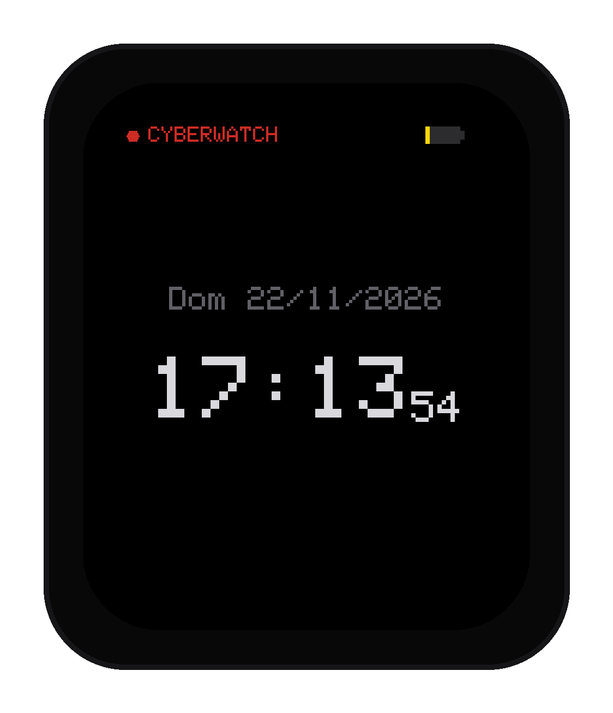

# CyberWatch

A DIY smartwatch project powered by the ESP32-C6, featuring a custom AMOLED interface, Wi-Fi connectivity, and real-time clock synchronization.

> [!NOTE]
> **Project Status:** 🚧 Work in progress.

## Preview

|             Normal             |                 Charging                  |                   Low battery                   |
| :----------------------------: | :---------------------------------------: | :---------------------------------------------: |
|  |  |  |

## Hardware

This project is being developed for the **Waveshare ESP32-C6-Touch-AMOLED-2.06**.

- **Microcontroller:** ESP32-C6
- **Display:** 2.06-inch AMOLED touchscreen
- **Development environment:** Arduino IDE
- **Programming language:** C++

**Official documentation:** [Waveshare ESP32-C6-Touch-AMOLED-2.06](https://docs.waveshare.com/ESP32-C6-Touch-AMOLED-2.06)

## Dependencies

The project uses the following libraries:

| Library          | Version |
| ---------------- | ------- |
| Arduino_DriveBus | 1.0.1   |
| Arduino_GFX      | 1.6.0   |
| SensorLib        | 0.3.1   |
| XPowersLib       | 0.3.0   |

These versions correspond to the libraries currently used during development.

### Library Installation

Install the required libraries in your Arduino sketchbook's `libraries` directory.

**Default Windows location:**

```text
Documents/
└── Arduino/
    └── libraries/
        ├── Arduino_DriveBus/
        ├── Arduino_GFX/
        ├── SensorLib/
        └── XPowersLib/
```

> [!IMPORTANT]
> The libraries directory may vary depending on your operating system and Arduino IDE configuration.
>
> You can check your sketchbook location under **File → Preferences → Sketchbook location**. Place the libraries inside its `libraries` subdirectory.

Restart the Arduino IDE after installing the libraries.

For additional installation and hardware configuration instructions, refer to the [official Waveshare documentation](https://docs.waveshare.com/ESP32-C6-Touch-AMOLED-2.06).

## Setup

1. Install the required libraries and configure the ESP32-C6 board in Arduino IDE.
2. Copy `secrets.example.h` to `secrets.h`.
3. Open `secrets.h` and fill in your home Wi-Fi and mobile hotspot credentials.
4. Compile and upload the firmware to the ESP32-C6.

> [!WARNING]
> `secrets.h` is ignored by Git and should never be committed to the repository.

> [!TIP]
> The ESP32-C6 only supports 2.4 GHz Wi-Fi. On iPhone, enable **Maximize Compatibility** in **Settings → Personal Hotspot**.

## Display Configuration

The interface is specifically designed for the **Waveshare ESP32-C6-Touch-AMOLED-2.06** display.

UI elements are manually positioned using `setCursor(x, y)` from the Arduino_GFX library.

> [!IMPORTANT]
> Cursor coordinates, text sizes, and spacing are tailored to the display's resolution and orientation. Using a different display may require layout adjustments.

## Current Features

- Digital clock interface
- Date and weekday display
- Wi-Fi connectivity with automatic fallback to a mobile hotspot
- NTP time synchronization
- Custom AMOLED interface
- Double-tap to wake the display
- Automatic screen timeout
- Battery indicator with charging (green + bolt) and low battery (yellow) states
- Swipe gesture detection (left and right)

## Development

CyberWatch is developed using the Arduino framework and C++.

The project is currently under active development, with a focus on building a lightweight, customizable smartwatch interface.
